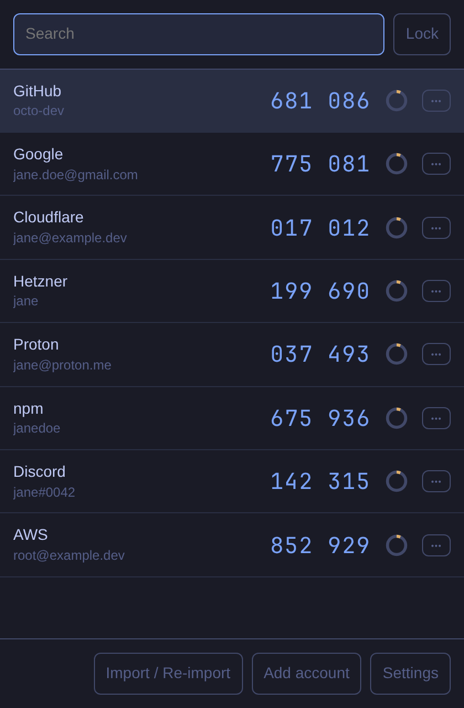
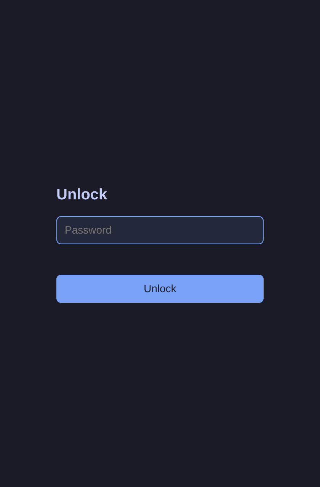
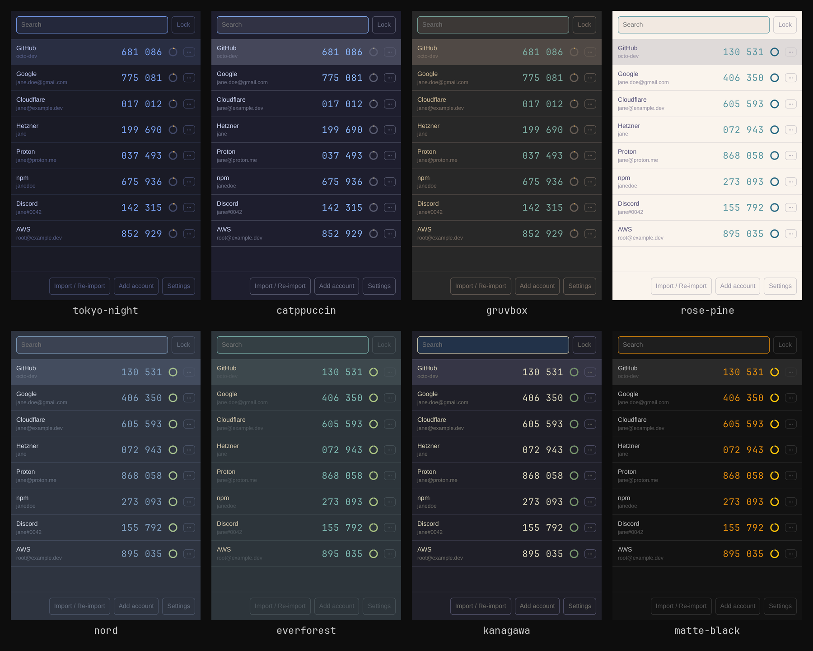

<p align="center"></p>

# Deskauth

A desktop TOTP authenticator. It imports your accounts from Google Authenticator and shows the 6 or 8 digit codes on your computer, so you don't need your phone for 2FA. Built with Tauri 2 (Rust backend, TypeScript UI). MIT license.

**Runs on Linux, Windows and macOS.** On Omarchy it follows your theme and changes live when you switch themes.

Not affiliated with Google.

<p align="center"> </p>

## Omarchy themes

The colors come from the current Omarchy theme (`~/.local/state/omarchy/current/theme/colors.toml`). On other systems it uses Tokyo Night.



Screenshots use demo accounts.

## Platforms

| System | How to get it |
|---|---|
| Linux (Arch / Omarchy) | `makepkg` from `packaging/arch`, see [Install on Arch](#install-on-arch) |
| Linux (other) | AppImage, .deb or .rpm from a release, or [build from source](#build-from-source) |
| Windows | .msi or .exe installer from a release, or build from source |
| macOS | .dmg from a release, or build from source |

Release builds are unsigned, see [Releases](#releases).

## Security trade-off

Read this before you use it.

- The codes live on the same computer as your passwords. If someone gets into this computer, they get both factors.
- Your master password is the only protection. The vault is an encrypted file (Argon2id key derivation, XChaCha20-Poly1305).
- There is no recovery. If you forget the master password, the vault cannot be opened. Delete the vault file (`vault.json`, see below) and import your accounts again.
- The app locks itself after 5 minutes of no use. A copied code is cleared from the clipboard after 30 seconds.

## Import from Google Authenticator

Google has no API, so the import uses the export screen of the phone app.

1. On the phone: Google Authenticator > menu > Transfer accounts > Export accounts. Pick the accounts.
2. In Deskauth: click Import / Re-import and scan the QR code on the phone screen with the computer camera.
3. Large lists are split into several QR codes. Scan each one.

Android blocks screenshots of the export screen, so use the camera there. iOS allows screenshots, so on iOS you can also import from an image file.

Importing again is safe. It merges into the vault and skips accounts that are already there (matched by secret).

## Build from source

Needs Node.js 22, Rust (stable) and the Tauri Linux libraries. On Debian/Ubuntu:

```bash
sudo apt-get install -y libwebkit2gtk-4.1-dev libappindicator3-dev librsvg2-dev libv4l-dev
```

Then:

```bash
npm ci
npm run tauri build
```

Packages are written to `src-tauri/target/release/bundle/`.

On Windows you need the Visual Studio C++ build tools and WebView2 (built into Windows 10 and 11). On macOS you need the Xcode command line tools. See https://v2.tauri.app/start/prerequisites/

## Install on Arch

```bash
cd packaging/arch && makepkg -si
```

This builds from the local checkout and installs `deskauth` to `/usr/bin`.

If your Rust or Node come from rustup or mise (not pacman), run `makepkg -fid` instead. The `-d` flag skips the dependency check, which would otherwise fail on the missing `rust` and `npm` packages.

## Releases

Pushing a `v*` tag builds unsigned packages (bundle targets are "all", so Linux gets AppImage, .deb and .rpm, Windows gets .msi and the NSIS .exe installer, macOS gets .dmg) and attaches them to a draft GitHub release.

macOS will warn that the app is from an unidentified developer because the release is not signed. To open it: right-click the app, choose Open, then confirm. Windows may show a SmartScreen warning for the same reason.

## Sign your own build

Releases are unsigned. To sign a build yourself, follow the Tauri guides:

- Windows: set `bundle.windows.certificateThumbprint` in `src-tauri/tauri.conf.json` and sign with `signtool`. See https://v2.tauri.app/distribute/sign/windows/
- macOS: set `APPLE_SIGNING_IDENTITY` and the notarization environment variables, then build. See https://v2.tauri.app/distribute/sign/macos/

## Hyprland keybind (optional)

Only one instance runs. Starting `deskauth` again focuses the open window, so a bind works as a toggle-to-front key:

```
bind = SUPER, A, exec, deskauth
```

## Where the vault is stored

The file is `vault.json`, in the Tauri app data directory for the identifier `dev.nichovski.deskauth`:

- Linux: `~/.local/share/dev.nichovski.deskauth/`
- macOS: `~/Library/Application Support/dev.nichovski.deskauth/`
- Windows: `%APPDATA%\dev.nichovski.deskauth\`

On Omarchy the app also follows the current theme colors.
